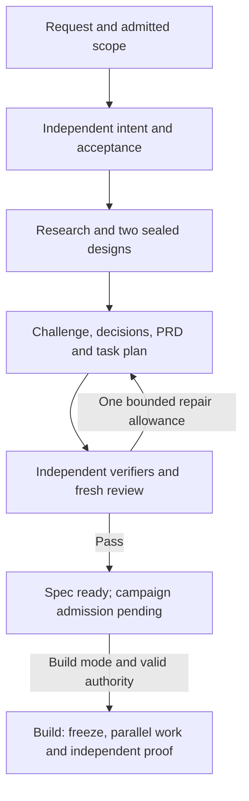

**CCC-Fusion request-to-code — Implementation PRD v3**  
**Date:** 2026-10-13  
**Status:** Reviewed implementation specification; runtime success remains unproven.

**1. Product outcome and authority**

Given a plain-language coding request and one admitted repository, Fusion must:

1. Preserve the user’s original intent.
2. Research the repository and relevant public technical sources.
3. Develop and challenge competing designs.
4. Produce a complete PRD and executable dependency plan.
5. In Build mode, implement, integrate and independently check runnable code.

Ryan must not manually rewrite requirements into tasks or approve every ordinary step. Ask only about consequential unresolved intent, missing prerequisites or budget, and actions outside admitted authority.

The dashboard is the everyday interface; CLI is the fallback. **Prove the campaign process before expanding the dashboard.** This order is already decided.

Retain the [existing twelve product criteria](</Users/ryanpappal/01_VAULT/KnR-Vault/00_MAIN/01_ActiveProjects/_tier-active/ccc-fusion/PRJ-AI-ccc-fusion-PRD-v0.3.md:215>). Ryan’s explicit model update supersedes their older GLM 5.2 wording: the routine pool becomes **GLM 5.3, GLM 5.3 Flash and MiniMax M3**, assigned by role.

Initial campaigns own one repository. Exclude arbitrary vault browsing, automatic new repositories, broad internal renaming and a second execution authority.

**2. Framework and ownership**

Use **Fusion’s native workflows, project PostgreSQL and embedded Pi 0.81.1**. Reuse existing TypeScript validation tooling. Add no alternative agent framework.

Pi supplies separately scoped model-and-tool sessions. Ordinary program code—the Fusion controller—owns:

- Permission and tool enforcement.
- Artifact validation and publication.
- Budgets and resource reservations.
- Dependency release and ownership leases.
- Confined command execution.
- Effect tracking, recovery, import and integration.

Models propose designs and judge evidence. They cannot override failed gates or authorize protected actions.

Preserve direct admitted-PRD intake alongside the new plain-language path. Extend existing native capabilities where necessary; do not rebuild behavior that already satisfies the required proof.

**3. Durable information**

One ordinary native planning task owns the run before campaign import.

Store immutable, versioned artifacts for:

- Original admitted request and scope.
- Independent acceptance cases.
- Repository snapshot and verified evidence.
- Separately sealed design alternatives.
- Decisions, objections and dispositions.
- Final PRD.
- Task graph, interfaces, ownership and integration plan.
- Verifier bundle.
- Model, budget and import receipts.

Each artifact records run, revision and stage IDs; input digests; producer instance and model; prompt/tool-policy version; output digest; and status.

Implement immutable publication and atomic reservations through native PostgreSQL methods where absent. Do not add another database or mutable ledger.

Store semantic content in task documents/artifacts. Run-audit events contain bounded IDs, counts, timestamps and outcomes.

Generated engineering decisions form a reviewed technical annex. Never attribute them to the user’s original words. **Correct provenance and preserved meaning require separate checks.**

**4. Exact production roles and models**

Production starts with **FULL-v2**.

| Binding | Exact OmniRoute model ID |
|---|---|
| GLM 5.3 | `glm/glm-5.3` |
| GLM 5.3 Flash | `glm/glm-5.3-flash` |
| MiniMax M3 | `minimax/MiniMax-M3` |

Qualify native registry bindings, effective provider/model identity and tool compatibility. Pin exact identities. Do not use floating aliases in a sealed campaign.

GLM 5.2 is excluded from new worker and fallback routes and cannot supply qualification for this profile. Preserve historical receipts honestly; negative tests may deliberately present rejected identities without calling them.

| Role | Model | Required responsibility |
|---|---|---|
| Intent/acceptance assessor | GLM 5.3 | Read original request and factual constraints before designs; produce observable criteria, exclusions and material questions |
| Repository/public researcher | M3 | Gather task-scoped facts, citations, versions, contradictions and unknowns |
| Bounded extraction leaves | Flash | Narrow research/extraction tasks under the researcher |
| Source verifier | GLM 5.3 | Independently check consequential claims against original sources |
| Designer A | M3 | Produce a sealed alternative without seeing B |
| Designer B | GLM 5.3 | Produce a materially different sealed alternative without seeing A |
| Decision synthesizer/spec author | GLM 5.3 | Produce supported decision records and the requirement-linked PRD |
| Execution planner/domain lead | GLM 5.3 | Produce task contracts, dependencies, ownership, integration and resource plans |
| Product adversary | M3 | Fresh review of original meaning, omissions and adverse cases |
| Technical/readiness critic | M3 | Separate fresh review of graph, interfaces, ownership and recovery |
| Verifier author | GLM 5.3 | Prepare independent checks and deliberately defective controls in a narrow scope |
| Verifier auditor | M3 | Read-only review of oracle meaning and observed runner results |
| Routine implementation/test writers | Flash | Implement frozen, independently owned tasks |
| Final campaign judge | M3 | Fresh instance uninvolved in code/verifier authorship; assess original intent and integrated proof |
| Controller, runner, importer, integrator, delivery guard | No model | Deterministic authority and execution |

Domain leads may split admitted objectives; they cannot expand scope or authority.

Every GLM/Flash-authored candidate receives fresh M3 review. M3-authored research/design receives GLM 5.3 review. Critics receive no previous verdicts.

GLM 5.3 and Flash are one family. They cannot satisfy cross-family review merely by reviewing each other. Separate contexts establish procedural separation, not statistically independent errors.

Critics deny edit/write and generic shell tools. Models receive no credential values, broad MCP control, SQL authority or admission-changing tools.

**Routing after failure:**

1. Shrink or clarify the Flash task.
2. Use a recorded GLM 5.3 next attempt within the same counter, repair and budget lineage.
3. If the ordinary pool remains insufficient, follow the approved higher escalation ladder: permitted OmniRoute OpenCode Go Kimi K3/Qwen 3.8; qualified AGY Gemini Pro; limited AGY Opus 4.6; Codex Terra high/xhigh, Terra max, then Sol max.

Freeze exact qualified current route identities. Unavailable lanes block; never invent IDs, silently swap models during an attempt, repair credentials from a leaf or substitute unapproved metered/direct Anthropic compute.

Modernizing the higher ladder requires a versioned policy amendment.

**Sol 6.1 and Opus 5.5 lead implementation of Fusion; they are not routine Fusion workers.**

**5. Agentic flow and review cycles**



This is intended behavior to implement. Spec mode stops at the reviewed specification; Build mode continues through its own acceptance gates.

**Pass 1:** Independent acceptance, verified research and separately sealed alternatives.

**Pass 2:** Cross-examination and the initial complete PRD/plan. Each material decision records proposal, evidence, objection, discriminating observation, supported disposition and remaining uncertainty. No majority vote.

Prepare and check the independent verifier bundle.

**Pass 3:** Fresh product, technical and oracle review of the exact candidate. Findings must reference requirements, sources, artifacts or concrete counterexamples.

| Counter | Operational definition |
|---|---|
| Iteration | One issued model call processing action feedback; **maximum 10 per node attempt** |
| Dispatch attempt | Incremented at durable reservation before dispatch; **maximum 3 per node lineage** |
| Review epoch | Committed independent findings plus adjudication for one candidate version |
| Stagnation | **Two consecutive epochs** without verified new evidence or material defect closure stop unresolved work |
| Repair chunk | One bounded rejected-candidate fix, including independent review |
| Global repair | **One epoch, maximum four chunks**, shared across planning and coding |

Initial drafting and expected TDD RED are ordinary work. A failed submitted acceptance candidate requests the shared repair allowance.

After repair, rerun affected gates and fresh final review. Further failed repair parks the affected lane.

Unknown dispatch cannot retry until reconciled. Tool-only work does not reset iteration counts. Splits and revisions preserve spending and parent counter lineage; renaming cannot reset a counter.

**6. Budgets and capacity**

Initial versioned safety ceilings:

| Mode/profile | Issued inference calls | Deadline | Allocation |
|---|---:|---:|---|
| Spec Standard | 1,536 | 12 hours | Planning only |
| Build Standard | 6,144 | 48 hours | Planning 1,536; implementation 3,072; independent review/proof 1,536 |
| Spec Large | 6,144 | 48 hours | Planning only |
| Build Large | 24,576 | 7 days | Planning 6,144; implementation 12,288; independent review/proof 6,144 |

These are starting safety policies, not claims of optimal cost.

For each phase:

- `N` includes estimated/admitted model nodes, leads, reviews and planned fan-out.
- Call fit floor: **`2 × (30 × N + 300)`**.
- Time fit: **twice the estimated critical path**.
- Use measured p90 durations; otherwise estimate 10 minutes planning/review, 60 minutes writer and 20 minutes heavy check.
- Initial per-attempt watchdogs: 30, 60 and 20 minutes respectively.

Do not widen failing test timeouts to manufacture success.

Default to Standard. Automatically select Large only when already authorized and actual route/resource capacity fits. Otherwise report exact insufficiency and the required amendment before exceeding the grant.

Reserve allocations before planning. The compiled Build graph must fit remaining allocations before dispatch. Dynamic research spends only planning capacity.

Reserve calls transactionally before dispatch. Possibly dispatched calls cannot be refunded after cancellation or lost acknowledgement. Pause, restart and model changes preserve spending, counters and deadline. Enlargement requires a new authorized amendment.

Request counts do not establish subscription deductions. Unknown quota/cost remains unknown. Block where a granted monetary/quota cap cannot be bounded. No metered fallback.

Maintain separate research/review, writer/worktree, heavy-check and integration pools. Heavy-check/integration start serialized. Other pools ramp from one against measured grants, accepted integrated throughput and pressure, then back off on degradation. One is a starting trial, never a permanent worker ceiling.

Release reservations only after owned descendants settle.

**7. Pass/fail gates**

| Gate | Required pass condition |
|---|---|
| **G0 Admission** | Exact request, repository/base, mode, source/tool policy, budget/resources, scope/action authority and permitted runtime version |
| **G1 Intent** | Every requested behavior/exclusion is observable; no guessed consequential user choice |
| **G2 Research/design** | Consequential facts verified or visibly assumed with falsification plans; FULL’s independent alternatives or evidenced infeasibility completed |
| **G3 Spec** | Every requirement maps to behavior, independent acceptance, tasks and evidence; blocking objections resolved; no invented facts, unauthorized scope or circular checks |
| **G4 Plan** | General acyclic graph, complete contracts/predecessors/interfaces/ownership, deterministic joins, confined proof commands and budget fit; scheduling simulation passes |
| **G5 Oracle** | Checks reject wrong implementations for the intended reason; setup failure distinguished from feature absence; independent controls and confinement audited |
| **G6 Build freeze/import** | Exact reviewed bytes and verifier-containing baseline; policy/budget/authority binding; compiler admission; complete transactional, idempotent import |
| **G7 Task/join** | Behavioral checks and fresh cross-family review; accepted predecessor trees; affected checks pass after integration |
| **G8 Campaign acceptance** | This request’s original acceptance passes on its exact integrated runnable candidate, with required interface/installed-target checks and fresh final judgment |
| **G9 Delivery** | Exact unused/unexpired action authority, green current checks and fresh remote/head match before dispatch |

G8 does not rerun Fusion’s entire qualification corpus after every everyday request.

Separate **release gates** require all twelve criteria, the held-out qualification, fresh final code review and actual installed Fusion CLI/dashboard journeys on one combined candidate.

Normal request-to-code execution requires a PostgreSQL qualification certificate binding the exact controller, policy, prompts, toolchain, runner, corpus and proof digests. Affected drift invalidates qualification.

Initial qualification uses a specific receipt restricted to owned disposable targets under the same safety/effect controls.

Pre-dispatch delivery refusal guarantees zero remote mutation. Lost acknowledgement after dispatch means `UNKNOWN_EFFECT`; reconcile or park truthfully.

Confidence, valid JSON, votes and fake-model tests cannot override failed gates.

**8. Verifiers, confinement and modes**

Reuse the [existing native macOS sandbox backend](/Users/ryanpappal/03_CODE/ccc-fusion/packages/engine/src/ccc-campaign-proof-sandbox.ts:477) and supervised runner. Presence/readiness alone is insufficient.

Before live model-authored code, prove enforcement of:

- Exact read-only source/verifier/toolchain access.
- Named scratch-only writes.
- Denied private/out-of-scope reads and symlink escapes.
- Default-denied network, except explicitly admitted owned loopback endpoints.
- Sealed environment and executables.
- Process/IPC escape and unowned-signal refusal.
- Bounded output/time, resource cleanup and descendant cancellation.

Controller allowlists mediate provider/MCP calls outside command sandboxes. Credentials are not inherited.

Every model-originated shell/package command uses a qualified confinement profile. No raw host fallback. Refuse checks when their declared boundary cannot be enforced.

Initial semantic-proof support is Darwin `sandbox-exec`. Non-Darwin support needs separate implementation/qualification. Do not automatically install a replacement container/tool. Deprecation is a maintenance risk, not a reproduced escape.

**Spec mode:** Store and audit the verifier bundle in native artifacts and owned disposable preparation space. End at `SPEC_READY`, with campaign admission pending. No selected-repository branch modification, runnable coding import or coding reserve.

**Build mode:** Materialize the audited bundle in an isolated verifier-preparation worktree. Record the transition from admitted base to verifier-containing baseline; freeze/import the application graph.

Spec-to-Build requires an explicit action, build scope/budget and G0–G6 rechecks. Previous spending stays counted. Revalidate baseline-specific proof; reuse semantic results only with identical complete input closure.

Verifier files remain outside application-writer scopes. Revisions require a new bundle/baseline, audit, bad controls and affected-proof invalidation. Critics judge observations; the controller executes commands.

**9. Parallel execution, effects and recovery**

Support multiple roots, successors, multi-parent joins and independent domains. No fake empty root or giant substitute task.

Workflow-item count is not task-node count. Prove mapping and authorization membership before changing identity guards.

Read-only research may grow within scope/grant. Freeze the writing graph. Changed edges, interfaces or ownership require validated revision, affected descendant invalidation and re-admission.

One current writer owns each atomic path/interface across campaigns. Sequential lease handoff is allowed. Lease loss revokes writing and publication.

Blocked domains do not stop independent ready work. Deterministic joins produce one combined candidate.

Durable mail is deduplicated and references artifact versions. Message arrival never grants authority or completes a dependency by itself.

Persist effect identity before calls/actions. Import identity is planning-run ID plus final digest. Settle/link import transactionally and reconcile lost acknowledgement.

Unknown effects require authoritative external inspection. Without reconciliation/idempotency support, park; do not promise exactly-once execution.

Cancel registered descendants, flush state, then release ownership. Cancellation does not undo external effects or refund uncertain consumption. Stale fences cannot publish.

Resume rechecks inputs, base, interfaces, tools, evidence freshness, authority, deadline and budgets. Invalidate affected results and resume committed stages.

Expose distinct states for awaiting intent, prerequisite/provider blockage, exhausted budget, unknown effect, pause/cancellation, spec ready, running, verification failure, acceptance and delivery.

**10. Dashboard and CLI**

Dashboard supports request submission, admitted-project selection, Spec/Build and Standard/Large budgets.

Show stage/graph, completed versus pending proof, blocked decisions, model receipts, remaining grant and delivery state.

Campaign-specific answer, pause, cancel, resume, build and budget controls bind the same run revision/custody as CLI. Retain the generic campaign mutation guard. Both interfaces use the same PostgreSQL projection.

Build proceeds within original scope without ritual plan approval. Protected actions retain exact authority.

Required commands:

```text
fn plan start --project ID --request-file PATH --mode spec|build --budget-profile standard|large --json
fn plan status RUN_ID --json
fn plan answer RUN_ID --decision ID --value VALUE
fn plan pause|cancel|resume RUN_ID
fn plan build RUN_ID --budget-profile standard|large
fn plan budget RUN_ID --amendment FILE
```

Exit `2` for usage errors, `1` for semantic refusal and `0` for success. Provide bounded stable diagnostics and JSON.

**11. Comparison profiles**

**FULL-v2:** The complete production role graph above.

**LEAN-v2 — isolated comparison only:**

- M3 independent acceptance.
- GLM 5.3 combined research/design/spec/plan.
- M3 independent combined critique.
- GLM 5.3 verifier author.
- M3 audit and final judging.
- Flash implementation.

It deliberately lacks FULL’s independent-alternative committee. Disclose that difference. Experimental admission never grants production readiness; safety, mechanical and external acceptance gates remain identical.

**ADAPTIVE-v2 — comparison:**

Always retain GLM 5.3 independent acceptance and research/A/spec/plan; independently sealed M3 alternative B; fresh M3 product/technical/oracle audit; GLM 5.3 verifier author; M3 final judging; and Flash implementation.

Add separate GLM 5.3 source verification for consequential external/conflicting claims; otherwise fresh critics verify sources alongside mechanical binding.

Promote to FULL for:

- Eight or more requirements.
- Two or more roots or multi-parent joins.
- Shared contracts/ownership.
- New dependencies.
- Network, permission or security changes.
- Contradictory/stale consequential evidence.
- Unresolved material assumptions.

Models may add risk flags but cannot clear deterministic ones. Escalate coverage within a run; never downgrade after exposure. Preserve accounting.

Keep benchmark answers and bad fixtures outside all planner/writer/critic packets and filesystem allowlists. Only evaluation runner/oracle curator accesses them.

Use separate development cases. Freeze prompts, models, profiles, tools and budgets; randomize comparison order.

Each case/profile is a separate bounded native job with identical base/evidence opportunities and FULL-sized granted capacity. Repairs consume existing allowance. Tuning against held-out failures invalidates held-out status; use a fresh sealed set for release re-evaluation.

**12. Release bar and all twelve criteria**

Freeze **24 held-out cases**, four each:

- Bounded features.
- Material ambiguity.
- Branching/shared interfaces.
- Contradictory/adversarial sources.
- Interruption/effect drift.
- Routing/resources.

Specify each expected terminal outcome before exposure. Fully specified cases require working checked code. Intentional ambiguity/denial requires the expected justified question/refusal.

FULL must achieve:

- **24/24** expected outcomes after permitted repair.
- At least **20/24** correct first-pass outcomes.
- **Zero** false-ready/false-accepted results.
- **Zero** critical defects or unauthorized effects.
- All required mechanical cases passing with zero skips.

Sample success does not establish universal unsupervised reliability.

| # | Existing product requirement retained |
|---:|---|
| 1 | Source-traceable graph without manual task transcription |
| 2 | No partial campaign/import after validation failure |
| 3 | Genuine general dependency graph |
| 4 | Measured concurrency ramp/backpressure |
| 5 | Writer exclusion and sequential ownership reuse |
| 6 | Restart/duplicate-safe non-authoritative mail |
| 7 | Predominant M3/GLM 5.3/Flash with requested/resolved receipts |
| 8 | Evidence-backed approved escalation |
| 9 | Separate heavy-verification capacity |
| 10 | Cancellation, restart, drift, stale authority, duplicates, conflicts and middle-failure integrity |
| 11 | Dashboard truth and CLI parity |
| 12 | Exact authorized delivery and refusal paths |

Predominance means **more than 50% of all inference attempts on routine-designated nodes**, including failures and escalation attempts. Freeze classification before dispatch; never relabel to improve the metric. Report higher routes separately.

Qualify actual native tool fidelity and runner identities. No GLM 5.2 certificate transfers.

Adaptive promotion requires equal correct outcomes, no additional critical/false-acceptance failures and at least **20% fewer issued calls or lower end-to-end latency**. Otherwise retain FULL. Votes cannot promote a profile.

**13. Implementation map and order**

Proposed focused modules:

- `/Users/ryanpappal/03_CODE/ccc-fusion/packages/core/src/ccc-planning/{types,schemas,policy}.ts`
- `/Users/ryanpappal/03_CODE/ccc-fusion/packages/core/src/task-store/ccc-planning-ops.ts`
- `/Users/ryanpappal/03_CODE/ccc-fusion/packages/engine/src/ccc-planning/{controller,stages,roles,gates,budget,verifiers,status}.ts`
- `/Users/ryanpappal/03_CODE/ccc-fusion/packages/cli/src/commands/plan.ts`
- Campaign-specific dashboard planning routes/components.

Reuse native importer, workflow storage, locks, mail, executor, authoring/compiler, scheduler, routing, recovery, joins, proof and landing modules. Preserve dependency injection. Avoid a giant executor expansion or incidental Pi upgrade.

| Increment | Work and exit proof |
|---|---|
| **I0 Preflight** | Current authority/instructions, custody/Git/PR/check/provider/runner facts as relevant; preserve unrelated work; authorized isolated worktree and verified/adjudicated base |
| **I1 Foundation** | Durable contracts/artifacts/counters/reservations/fences/effects and confined runner; offline publication/import/restart/escape proof |
| **I2 First real slice** | FULL roles, modes, oracles and import bridge; actual M3/5.3/Flash installed-CLI request-to-code under exact live authority |
| **I3 Parallel execution** | General graph, ownership, domain fan-out, mail, resource ramp/heavy pools; disposable Git/PostgreSQL/provider proof |
| **I4 Recovery/delivery** | Cancellation, revisions, unknown effects, routing/escalation and delivery fault matrix |
| **I5 Interface** | Dashboard flows, CLI parity, documentation reconciliation and existing design/API conventions |
| **I6 Qualification** | Final held-out evaluation, exact-tree review, all twelve criteria, authorized durable installation, fresh installed acceptance and controlled remote delivery proof |

An earlier October 13 local snapshot showed one commit ahead, 23 behind and six untracked entries. That is historical local custody evidence—not a remote or service-health check. Refresh during I0. Do not repair/develop in primary or execute historical handoffs.

I2 success is the first milestone, never complete-product acceptance.

Every increment has explicit ownership, intended behavioral RED, smallest GREEN, appropriate refactor checks and fresh review. Leaves never push/merge; the implementation leader does not merge `main`.

Provide the required changeset for published CLI behavior. No release or production activation is inferred.

**14. Verification and completion**

Add targeted planning contract, role, gate, budget, confinement, real-PostgreSQL recovery, real-Git verifier, CLI and dashboard suites.

Extend existing compiler/import/fan-out/join/status, restart/cancel, ownership/mail/routing/proof/delivery tests.

Required negative cases include:

- Omitted intent, changed exclusions, fake evidence and unresolved objections.
- Unsafe graphs, overlapping leases and invalid joins.
- Stale artifacts/models/authority.
- Circular or weakened verifiers.
- Lost acknowledgement, duplicate replay and descendant leaks.
- Infrastructure failure incorrectly counted as behavioral RED.
- Confinement escape/refusal controls.

Reconcile exclusions and quarantine ledger. Missing or skipped required proof fails.

Retain the [current verification distinctions](/Users/ryanpappal/03_CODE/ccc-fusion/docs/testing.md:43):

```text
Focused package Vitest checks
pnpm verify:ccc-prd-product
pnpm lint
pnpm typecheck
pnpm build
pnpm test:gate
task ci
task verify
```

The final deep `task verify` sweep is explicitly requested for this broad implementation. `verify:fast` is test-free. Synthetic acceptance does not prove real quality.

Broaden/repeat checks only for changes, failures or unresolved concerns. Final evidence binds the exact combined candidate.

Implement these new commands:

```text
pnpm test:ccc-planning
pnpm verify:ccc-planning-offline
pnpm verify:ccc-planning-live --profile full|adaptive|lean --candidate PATH --approval-receipt PATH
pnpm verify:ccc-planning-installed --candidate PATH --approval-receipt PATH
```

Contracts:

- **Targeted:** bounded named suites.
- **Offline:** owned disposable PostgreSQL/Git, injected models, no external network, exact zero-skip mapping.
- **Live:** actual pinned models, sealed cases and job budgets.
- **Installed:** neutral-directory dashboard/CLI journeys and complete release matrix.

Fail nonzero for missing evidence, skips, wrong identity/tree, unowned resources, absent authority or partial proof.

Port `4040`, unrelated listeners, credentials and private vault remain untouched. No hidden metered fallback. Verify the actual repository-scoped CI runner. Do not claim Linux semantic proof without its backend.

The final packet contains exact candidate/install/tree, original acceptance and twelve-criterion results, actual models/tools/runner, commands/fault/held-out results, final review/dispositions, remaining defects and rollback/resume instructions.

Keep proposed, implemented, tested, installed and demonstrated-in-use states separate. Required evidence marked **NOT RUN/BLOCKED** prevents a completion claim.
